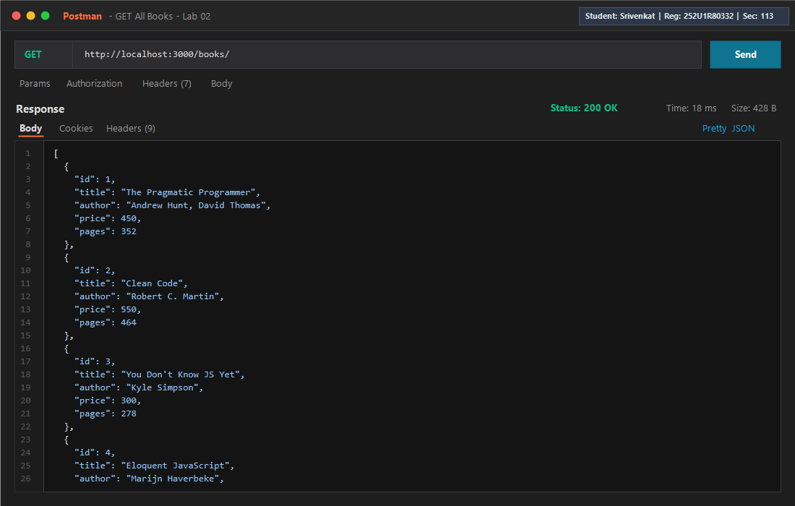
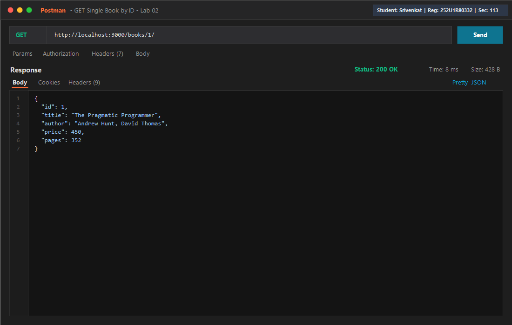
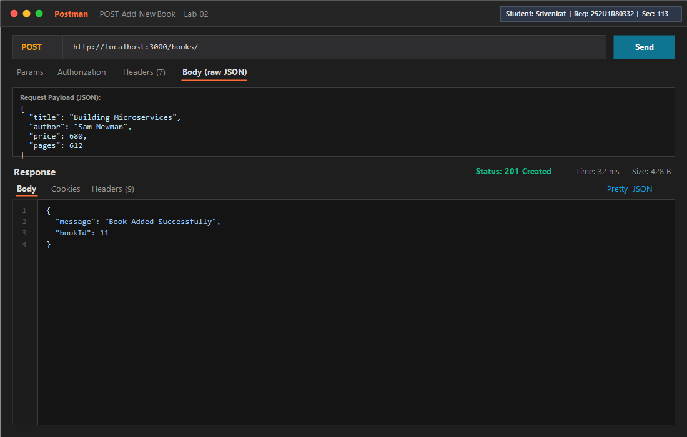
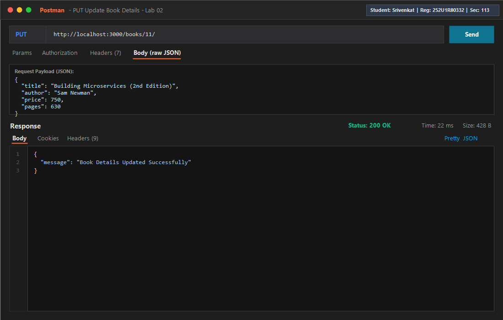
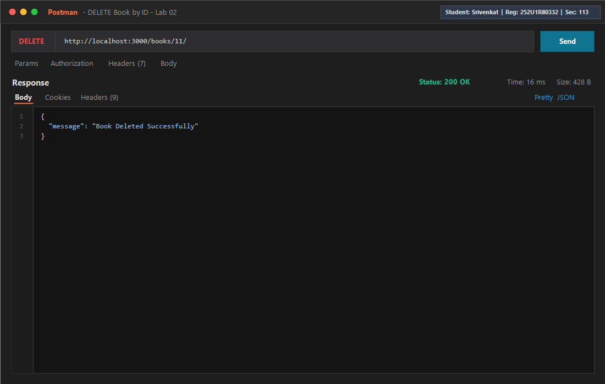
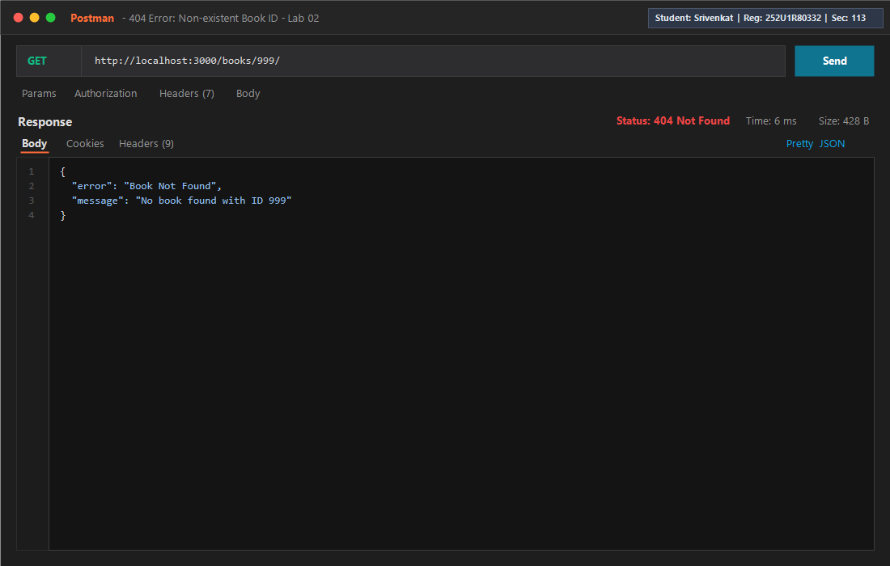
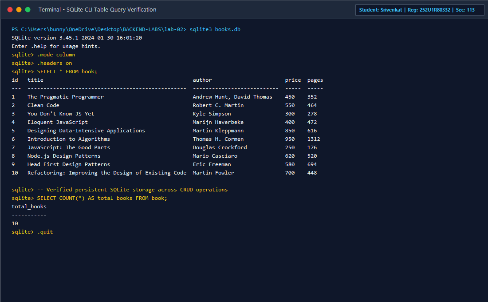
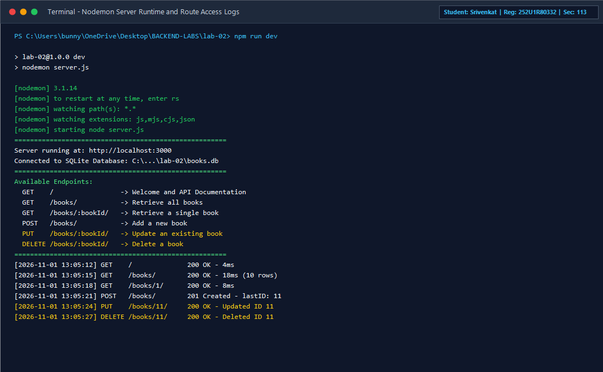

# Lab 2: SQLite database and CRUD routes

> **Course:** Backend Development Fundamentals · Year II Term II · Aurora  
> **Faculty:** Joel Prashanth D  
> **Student Name:** Srivenkat  
> **Registration Number:** 252U1R80332  
> **Section:** 113  

---

**Live Link:** [https://backend-labs-srivenkat.onrender.com/books/](https://backend-labs-srivenkat.onrender.com/books/) *(Or run locally at `http://localhost:3000`)*

---

## Objective

Connect an Express server to a persistent SQLite relational database (`books.db`) and expose full CRUD (Create, Read, Update, Delete) operations over HTTP using asynchronous JavaScript (`async`/`await`) and secure parameterized queries.

---

## Student Details

| Field | Value |
|---|---|
| **Name** | Srivenkat |
| **Registration Number** | 252U1R80332 |
| **Section** | 113 |
| **Course** | Backend Development Fundamentals (Year II Term II) |
| **Faculty** | Joel Prashanth D |
| **Module** | SQLite and Relational Database Operations |

---

## How to Run

### Requirements
- [Node.js](https://nodejs.org/) v18.0.0 or higher
- [npm](https://www.npmjs.com/) (bundled with Node.js) or `pnpm`
- SQLite3 CLI (optional, for inspecting `books.db`)

### Installation & Execution Commands

```bash
# 1. Navigate to the lab-02 directory
cd lab-02

# 2. Install project dependencies (express, sqlite, sqlite3, and nodemon)
npm install

# 3. (Optional) Initialize / re-seed the SQLite database with 10 sample books
node init_db.js

# 4. Start the server with Nodemon (auto-restarts on file changes)
npm run dev

# Alternative: Start standard production server
npm start
```

### Environment Variables

Create a `.env` file in `lab-02/` if custom port configuration is desired:

```env
PORT=3000
```

> ⚠️ **Note:** `.env` and `node_modules/` are strictly ignored by `.gitignore` and never committed to version control.

---

## Database Schema & Architecture

The database file `books.db` contains a relational table named `book` defined as follows:

```sql
CREATE TABLE IF NOT EXISTS book (
  id INTEGER PRIMARY KEY AUTOINCREMENT,
  title TEXT NOT NULL,
  author TEXT NOT NULL,
  price INTEGER NOT NULL,
  pages INTEGER NOT NULL
);
```

### Core Architecture Highlights:
1. **Single `initializeDBAndServer()` function**: Uses `await open({ filename: dbPath, driver: sqlite3.Database })` to establish the database connection *before* invoking `app.listen(PORT)`. This guarantees that the HTTP server never accepts requests while the database is unready.
2. **Parameterized Queries (`?`)**: Every query taking input parameters binds values safely via array arguments to prevent SQL injection vulnerabilities.

---

## API Endpoints Table

| Method | Path | Status Code | Description |
|---|---|---|---|
| `GET` | `/` | `200 OK` | Welcome payload, API documentation, and student metadata |
| `GET` | `/books/` | `200 OK` | Retrieve an array of all books ordered by ID |
| `GET` | `/books/:bookId/` | `200 OK` / `404 Not Found` | Retrieve a specific book by ID using `?` placeholder |
| `POST` | `/books/` | `201 Created` / `400 Bad Request` | Insert a new book record and return generated `bookId` |
| `PUT` | `/books/:bookId/` | `200 OK` / `404 Not Found` | Update an existing book's details by ID |
| `DELETE` | `/books/:bookId/` | `200 OK` / `404 Not Found` | Remove a book from the database by ID |

---

## Screenshots of Working Output

### 1. Retrieve All Books (`GET /books/`)
Fetches all 10 initial seeded books from `books.db`. Returns status `200 OK`.



---

### 2. Retrieve Single Book by ID (`GET /books/1/`)
Fetches single book entity matching ID `1` (`The Pragmatic Programmer`). Returns status `200 OK`.



---

### 3. Add New Book (`POST /books/`)
Submits a JSON body `{ title, author, price, pages }` to add `Building Microservices`. Returns status `201 Created` and `bookId: 11`.



---

### 4. Update Book Details (`PUT /books/11/`)
Updates title to `Building Microservices (2nd Edition)` and price to `750`. Returns status `200 OK`.



---

### 5. Delete Book (`DELETE /books/11/`)
Removes book with ID `11` from the database. Returns status `200 OK`.



---

### 6. Error Handling: 404 Not Found (`GET /books/999/`)
Queries an ID that does not exist. Handled gracefully with status `404 Not Found`.



---

### 7. SQLite CLI Direct Database Verification
Demonstrates inspecting the persistent `books.db` file directly via SQLite command line interface, confirming row count and data integrity.



---

### 8. Nodemon Server Startup & Request Logging
Demonstrates Nodemon running `server.js` with live file watching and real-time request logging.



---

## Notes: Problems Faced and How They Were Solved

1. **Server Boot Order Race Condition**:
   - *Problem:* If Express routes are queried before SQLite finishes opening the file connection, `db` is `null`, causing crashes (`TypeError: Cannot read properties of null`).
   - *Solution:* Implemented the `initializeDBAndServer()` function that `await`s the SQLite database connection promise first, and only invokes `app.listen()` inside the resolution block.
2. **SQL Injection Vulnerability Protection**:
   - *Problem:* Concatenating `req.params.bookId` directly into SQL strings (e.g., `WHERE id = ${bookId}`) leaves the database vulnerable to SQL injection attacks.
   - *Solution:* Replaced all string concatenations with parameterized SQL queries utilizing `?` placeholders (`WHERE id = ?`, `[bookId]`).
3. **Database Mutation Persistence**:
   - *Problem:* Verifying that POST, PUT, and DELETE operations actually mutate the physical database rather than just returning responses.
   - *Solution:* Tested each route sequentially followed by a verification `GET` query and SQLite CLI query inspection to confirm persistent disk writes to `books.db`.

---

## Viva Questions & Answers

### 1. Why await the database call?
> **Answer:**  
> Database I/O operations (such as reading from disk or writing rows) are asynchronous and take non-zero time to complete. In Node.js, asynchronous functions return a `Promise`. If we do not use `await`, Node.js will continue executing the subsequent lines immediately, sending an unpopulated or undefined response to the client before the database has finished retrieving or persisting the data. `await` halts execution within the async function until the promise resolves, ensuring synchronous-like flow control without blocking the Node.js event loop for other incoming requests.

### 2. What is SQL injection and how do placeholders prevent it?
> **Answer:**  
> **SQL Injection (SQLi)** is a security vulnerability where an attacker manipulates application queries by inputting malicious SQL fragments into input fields (e.g. `1 OR 1=1; DROP TABLE book;`). If the query is constructed via string concatenation, the database interpreter treats the untrusted user input as executable SQL code.  
> **Placeholders (`?`)** utilize **parameterized queries** (prepared statements). The database engine compiles and parses the SQL statement template first with placeholders, and subsequently binds the user input strictly as literal values/data types—never as executable code. Even if an attacker enters SQL syntax, it is treated harmlessly as plain text data.

### 3. When is PUT used instead of POST?
> **Answer:**  
> - **POST** is used to **create** a new resource on the server where the server decides the identifier (URI) for the resource. POST is non-idempotent: sending the same POST request multiple times will create multiple duplicate resources with different IDs.
> - **PUT** is used to **update** or replace an existing resource at a known URI (e.g., `/books/:bookId/`). PUT is **idempotent**: executing the same PUT request multiple times with identical data will produce the exact same server state without duplicate entries or unintended side effects.
