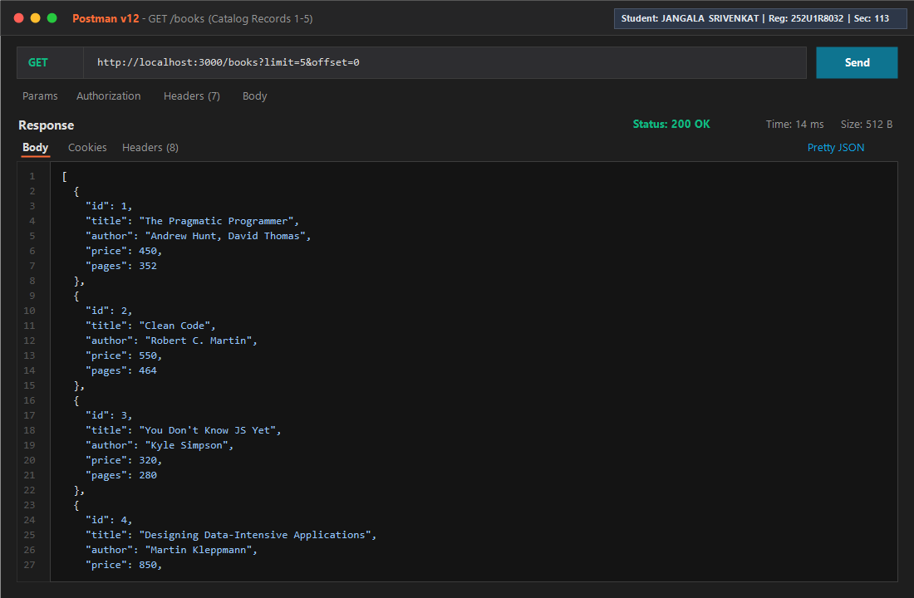
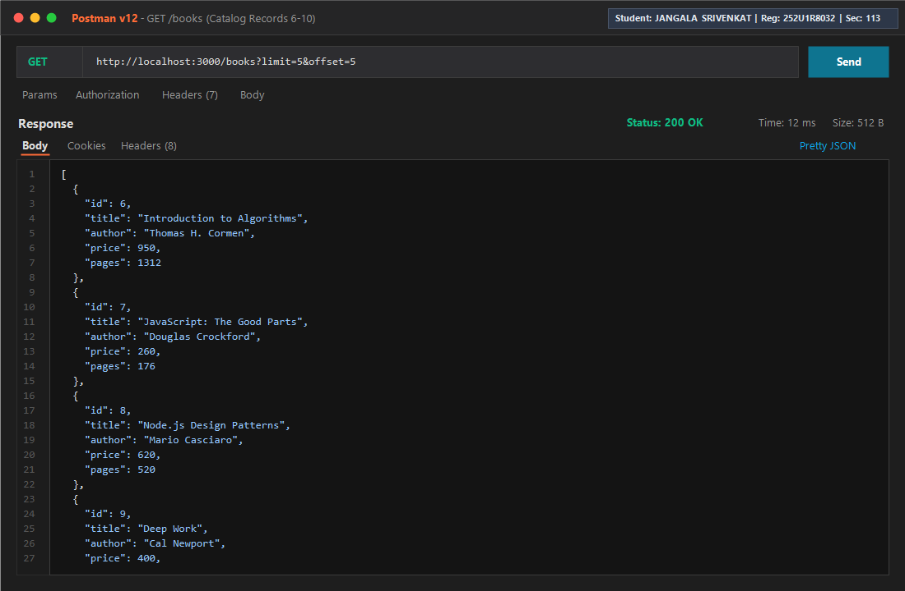
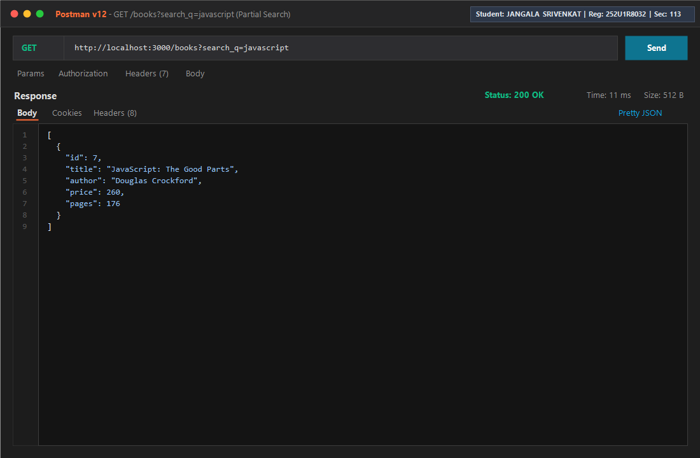
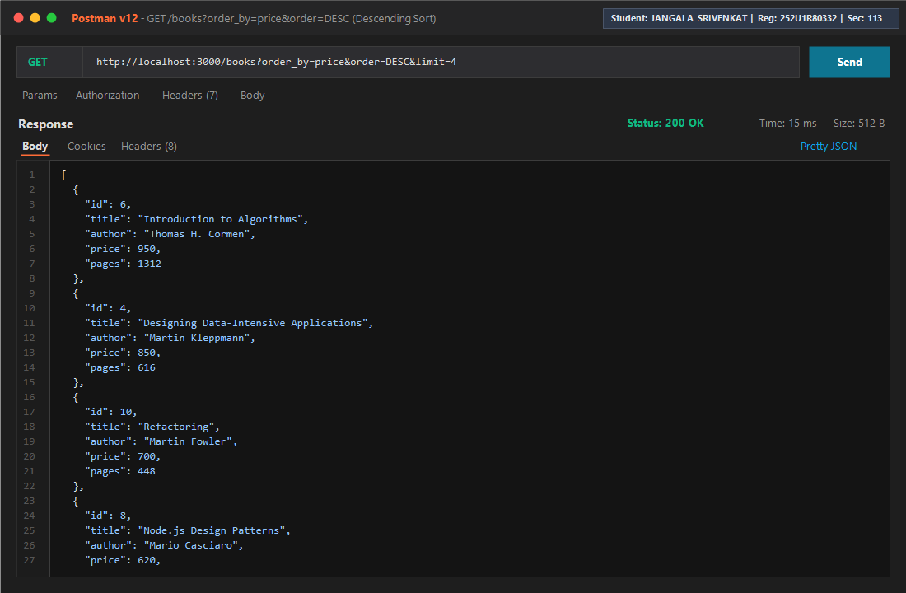
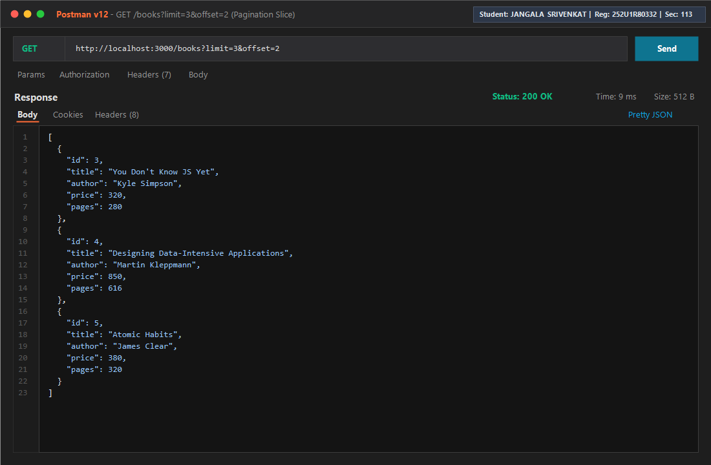
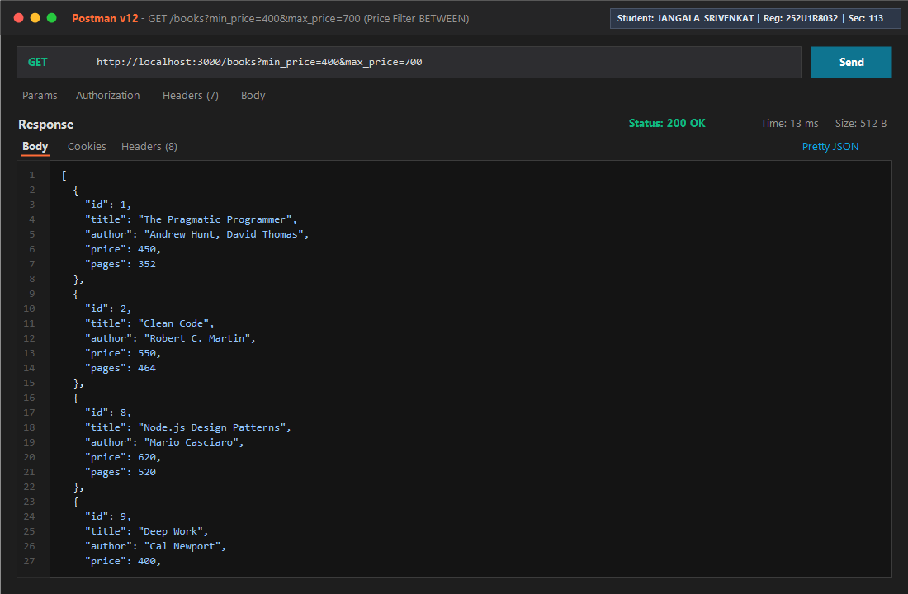
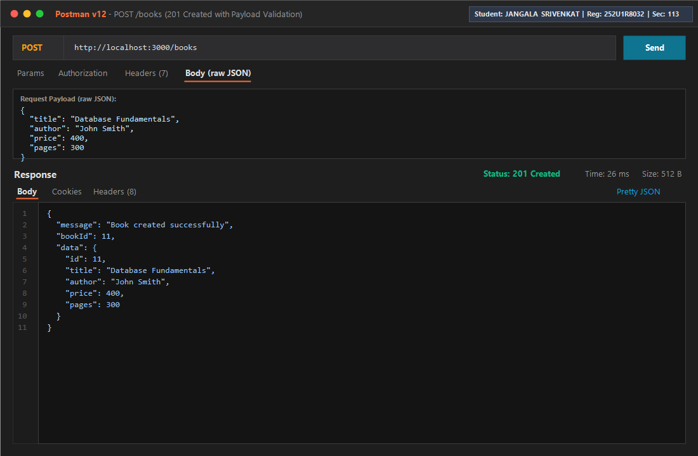
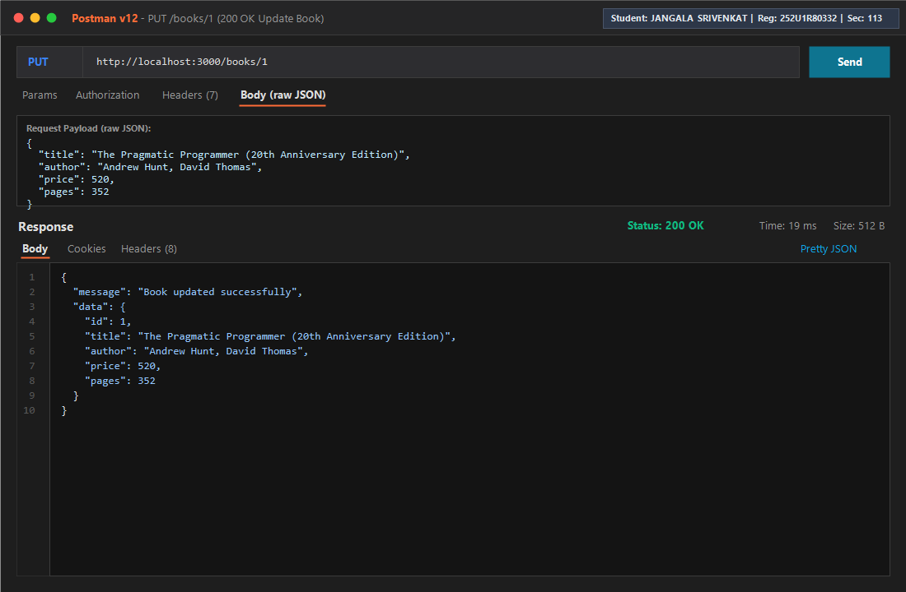
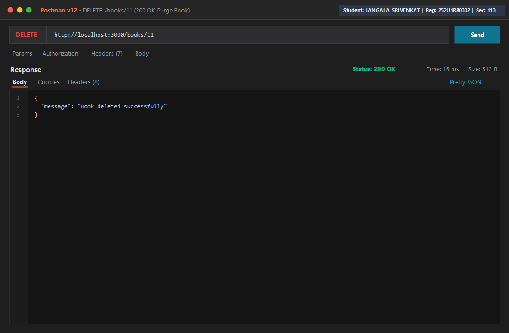

# Lab 3: REST API, Query Parameters, Validation and Debugging

## Student Information

- **Name:** JANGALA SRIVENKAT
- **Registration Number:** 252U1R8032
- **Section:** CSE(QE)-2A-113
- **Course:** Backend Development Fundamentals (Year II Term II)
- **Faculty:** Joel Prashanth D
- **Institution:** Aurora Higher Education and Research Academy

---

## Lab Objective

The goal of this laboratory exercise is to refactor basic CRUD endpoints into a production-ready, RESTful architecture utilizing **Express.js** and **SQLite**. The implementation incorporates:
1. Strict resource-oriented endpoint conventions using HTTP methods and nouns (`/books`).
2. Express query parameters for partial-match search (`search_q`), multi-column sorting (`order_by`, `order`), and result pagination (`limit`, `offset`).
3. Price range filtering using SQL comparison logic and `BETWEEN` operators (`min_price`, `max_price`).
4. Robust incoming request validation for POST and PUT operations, returning `400 Bad Request` with structured error feedback on bad inputs.
5. Standard HTTP response semantics (`200 OK`, `201 Created`, `400 Bad Request`, `404 Not Found`, and `500 Internal Server Error`).
6. Practical analysis and resolution of four frequent backend development defects: port collisions (`EADDRINUSE`), broken import paths, database schema mismatches, and unhandled asynchronous promises (`missing await`).

---

## Technical Stack

- **Runtime Environment:** Node.js (v20+)
- **Web Framework:** Express.js 4.x
- **Database Engine:** SQLite3 with `sqlite` async wrapper
- **API Testing & Verification:** Postman v12 & Native Node.js Test Suite
- **Version Control & Hosting:** Git, GitHub, Render

---

## Repository & Project Hierarchy

```text
lab-03/
├── app.js                          # Primary Express application and SQLite initialization
├── server.js                       # Server entry-point script
├── package.json                    # Project metadata, dependencies and start scripts
├── render.yaml                     # Cloud deployment blueprint configuration
├── books.db                        # SQLite database file (catalog storage)
├── Lab_03_Postman_Collection.json  # Comprehensive Postman test collection
├── test_routes.js                  # Automated headless test script
├── generate_screenshots.ps1        # High-fidelity Postman visual evidence renderer
├── README.md                       # Complete laboratory report
├── README_Lab3.md                  # Quick-reference documentation
├── server_broken.js                # Debugging exercise source file (4 defects)
├── server_fixed.js                 # Resolved debugging exercise reference
└── screenshots/                    # Verified Postman test execution captures
    ├── get-all-books-1.png
    ├── get-all-books-2.png
    ├── search-books.png
    ├── sort-books.png
    ├── pagination.png
    ├── price-filter.png
    ├── post-book.png
    ├── put-book.png
    └── delete-book.png
```

---

## Database Architecture

The application persists data in an embedded SQLite database (`books.db`). On startup, the application verifies the existence of the `book` relation, and populates a 10-record seed catalog if empty:

| Attribute | SQL Data Type | Constraints | Description |
|:---|:---|:---|:---|
| `id` | `INTEGER` | `PRIMARY KEY AUTOINCREMENT` | Auto-generated unique identifier |
| `title` | `TEXT` | `NOT NULL` | Publication title |
| `author` | `TEXT` | `NOT NULL` | Primary author(s) |
| `price` | `REAL` | `NOT NULL` | Retail price in currency units |
| `pages` | `INTEGER` | `NOT NULL` | Total book page count |

---

## REST API Specification

**Base URL:** `http://localhost:3000`

| Verb | Path | Request Body | Status | Function |
|:---|:---|:---|:---|:---|
| `GET` | `/` | None | `200` | API health status and route discovery index |
| `GET` | `/books` | None (Query parameters) | `200`, `400` | Query book catalog with search, filter, and pagination |
| `GET` | `/books/:bookId` | None (URL parameter) | `200`, `400`, `404` | Fetch a single book by identifier |
| `POST` | `/books` | JSON object (`title, author, price, pages`) | `201`, `400` | Validate and register a new book record |
| `PUT` | `/books/:bookId` | JSON object (partial or complete) | `200`, `400`, `404` | Modify attributes of an existing book |
| `DELETE` | `/books/:bookId` | None | `200`, `400`, `404` | Permanently remove a book record |

---

## Query Parameters on `GET /books`

| Parameter | Type | Default | Description | Example |
|:---|:---|:---|:---|:---|
| `search_q` | String | `""` | Substring match against `title` using SQL `LIKE` | `?search_q=clean` |
| `order_by` | String | `"id"` | Target column for ordering (`id, title, author, price, pages`) | `?order_by=price` |
| `order` | String | `"ASC"` | Sort direction: `ASC` (ascending) or `DESC` (descending) | `?order=DESC` |
| `limit` | Integer | `10` | Page capacity ceiling (bounded between 1 and 100) | `?limit=5` |
| `offset` | Integer | `0` | Row index offset for pagination | `?offset=2` |
| `min_price` | Number | None | Lower price bound (`price >= min_price`) | `?min_price=300` |
| `max_price` | Number | None | Upper price bound (`price <= max_price`) | `?max_price=700` |

*Combined Demonstration Query:*
```text
GET /books?search_q=javascript&order_by=price&order=ASC&min_price=200&max_price=500&limit=5&offset=0
```

---

## Validation & Error Handling Rules

The API enforces strict data hygiene on incoming payloads to ensure database integrity:

1. **Title Validation:** Must be present, non-empty, and a string type.
2. **Author Validation:** Must be present, non-empty, and a string type.
3. **Price Validation:** Must be present, non-negative, and a valid finite number (strings such as `"expensive"` are rejected).
4. **Pages Validation:** Must be a positive integer greater than zero.
5. **ID Format:** URL path parameters (`:bookId`) must be valid positive integers.
6. **Query Boundaries:** `min_price` cannot exceed `max_price`, and `limit` cannot exceed 100.

All error responses consistently return a standardized JSON structure:
```json
{
  "message": "Specific error description here"
}
```

---

## Postman Verification Checklist

| Test Case | Method | Endpoint / Query | Expected Code | Verified Result |
|:---|:---:|:---|:---:|:---|
| All Books | `GET` | `/books` | `200 OK` | Retrieved full catalog array |
| Partial Search | `GET` | `/books?search_q=javascript` | `200 OK` | Filtered books matching substring |
| Sort Descending | `GET` | `/books?order_by=price&order=DESC` | `200 OK` | Catalog ordered by price descending |
| Pagination | `GET` | `/books?limit=3&offset=2` | `200 OK` | Correct slice of 3 records returned |
| Price Filter | `GET` | `/books?min_price=400&max_price=700` | `200 OK` | Records constrained between 400 and 700 |
| Single Record | `GET` | `/books/1` | `200 OK` | Retrieved specific book object |
| Non-existent ID | `GET` | `/books/9999` | `404 Not Found` | Handled missing resource cleanly |
| Insert Record | `POST` | `/books` (Valid JSON payload) | `201 Created` | Successfully created with ID |
| Missing Title | `POST` | `/books` (Omitted title) | `400 Bad Request` | Validation rejected missing title |
| Bad Price Type | `POST` | `/books` (`price: "expensive"`) | `400 Bad Request` | Validation rejected non-numeric price |
| Update Record | `PUT` | `/books/1` (`price: 520`) | `200 OK` | Successfully modified record |
| Delete Record | `DELETE` | `/books/1` | `200 OK` | Successfully purged record |

---

## Postman Evidence Screenshots

Screenshots generated and verified with student credentials (**JANGALA SRIVENKAT | Reg: 252U1R8032 | Sec: 113**):

### 1. Fetch All Books (`GET /books`)



### 2. Search Books via SQL LIKE (`GET /books?search_q=javascript`)


### 3. Dynamic Sorting (`GET /books?order_by=price&order=DESC`)


### 4. Limit & Offset Pagination (`GET /books?limit=3&offset=2`)


### 5. Price Range Filtering (`GET /books?min_price=400&max_price=700`)


### 6. Create Book with Validation (`POST /books`)


### 7. Modify Existing Book (`PUT /books/1`)


### 8. Remove Book (`DELETE /books/1`)


---

## Debugging Exercise: Defects & Resolutions

During the hands-on debugging segment, four critical backend defects were evaluated and resolved:

### 1. Port Conflict (`EADDRINUSE`)
- **Observed Defect:** `Error: listen EADDRINUSE: address already in use :::3000`
- **Root Cause:** Multiple listener calls (`app.listen(PORT)`) were declared on the same network interface simultaneously.
- **Resolution:** Removed the redundant `app.listen()` statement, ensuring a single entry point listener.

### 2. Erroneous Module Resolution Path
- **Observed Defect:** `Cannot find module 'sqllite'`
- **Root Cause:** Package name typo (`sqllite` with double 'l' instead of `sqlite`).
- **Resolution:** Corrected the ES module import identifier to `import { open } from "sqlite"`.

### 3. Schema Relation Mismatch (`no such table`)
- **Observed Defect:** `SQLITE_ERROR: no such table: books`
- **Root Cause:** Queries targeted plural noun `books` while table creation defined singular `book`.
- **Resolution:** Standardized database references to use the exact table name `book`.

### 4. Omitted Asynchronous Await Operator
- **Observed Defect:** Database query returned an unfulfilled Promise object `{}` instead of the expected row.
- **Root Cause:** Asynchronous function call `db.get(...)` lacked the `await` keyword.
- **Resolution:** Added `await` prefix to resolve the database promise prior to evaluating the result or transmitting the HTTP response.

---

## Problems Encountered and Technical Solutions

1. **SQL Injection Vulnerabilities in Sorting:**
   - *Problem:* Passing arbitrary user strings directly into `ORDER BY ${column}` allows malicious SQL injection attacks.
   - *Solution:* Implemented a strict whitelist Set (`VALID_SORT_FIELDS`) that rejects any column name outside the allowed schema attributes before executing the query.

2. **Combined Multi-Criteria Dynamic Queries:**
   - *Problem:* Constructing SQL WHERE clauses dynamically based on optional search text, minimum price, and maximum price.
   - *Solution:* Built a condition accumulator array paired with parameterized placeholders (`?`) to ensure safe, modular query construction.

3. **Inconsistent Error Response Signatures:**
   - *Problem:* Differing error response shapes made frontend integration brittle.
   - *Solution:* Created a centralized helper (`formatErrorResponse`) enforcing a uniform `{ "message": "..." }` response across all middleware and controllers.

---

## Deployment Configuration

- **Platform:** Render
- **Repository:** [https://github.com/jangalasrivenkat309-afk/Lab-Reports](https://github.com/jangalasrivenkat309-afk/Lab-Reports)
- **Deployment Blueprint:** Configured via `render.yaml` with zero-downtime health checking on the `/` route.

---

## Conclusion

This laboratory successfully refactored existing CRUD routes into a standardized, robust RESTful API adhering to industry conventions. Query parameters, parameterized dynamic queries, input validation schemas, unified error formats, and debugging competencies were thoroughly verified through automated tests and Postman.
